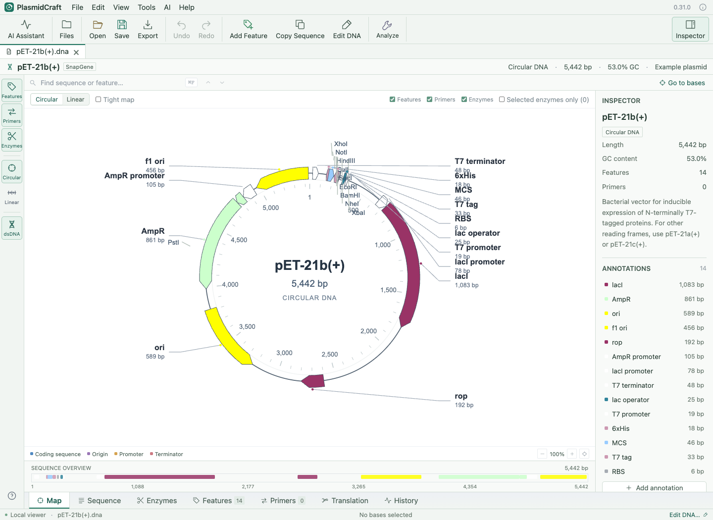

# PlasmidCraft 0.31

Prepared by **Huiwang Ai at the University of Virginia with ChatGPT Codex**. Contact: [huiwang.ai@virginia.edu](mailto:huiwang.ai@virginia.edu).

Desktop test release. Source and installer packages are versioned **0.31.0**.

An independent desktop workspace for plasmid viewing, sequence editing, protein analysis and cloning design. Built with JavaScript, Rust and Tauri 2. The application embeds its interface and works without Node.js, Python or a local web server.



## Install

Use the package matching your computer from the release assets:
https://github.com/AlvinAi-cloud/PlasmidCraft/releases/tag/v0.31

| Platform | Package | Requirement |
| --- | --- | --- |
| Mac Apple Silicon | `PlasmidCraft-0.31.0-macOS-arm64.dmg` | M1 or newer; macOS 12.3+ |
| Mac Intel | `PlasmidCraft-0.31.0-macOS-x64.dmg` | Intel; macOS 12.3+ |
| Windows | `PlasmidCraft-0.31.0-Windows-x64-setup.exe` | Windows 10/11 x64; WebView2 Runtime |

Mac: open the disk image and drag **PlasmidCraft 0.31** to Applications. Windows: run the per-user installer. WebView2 may need an Internet connection for installation. Subsequent local biology tools work offline.

**0.31 packages are test installers:** Mac apps are ad-hoc signed, without Apple notarization; Windows has no publisher signature. Operating-system trust warnings are expected. See [installation and signing](docs/RELEASE.md) and [verification status](docs/VALIDATION.md) before distribution. Architecture/package inspection does not replace acceptance testing on each platform.

## Features

- Circular/linear maps with an optional tight curved-label publication layout that hides enzyme markings when activated, a Common enzymes group with optional custom Map selections, a width-adaptive continuous scrolling Sequence view with CDS residue numbering every five residues with strand-specific primer letters, mismatch highlights, separate 5′ tails, codon blocks and optional reading frames in one-letter or three-letter notation, a clickable annotation overview pinned below Map and Sequence, centered annotation navigation, packed non-overlapping CDS lanes, linked DNA/protein selection with copy/FASTA choices, feature/primer lists, restriction sites, six-frame translation, ORFs, direct sequence editing and branching undo history.
- GenBank, DNA FASTA/text, SnapGene `.dna`, Sanger `.ab1`, native `.pcraft` documents and protein FASTA/text/`.pcprotein` import. Protein-only imports are available under File → New from Pasted Protein and Tools → Protein Documents.
- Public feature catalog with 68 entries and per-entry sources, editable user libraries, and reviewed annotation matching.
- 407 enzyme entries from checked NEB and Thermo Fisher tables; 377 modeled double-strand cleavage patterns and 18 Golden Gate sequence-design choices. The Common enzymes group matches the map priority list; select the common set explicitly or clear custom map selections independently of digest prediction. No enzymes are preselected; the default map uses an automatic single-cutter display. Special enzymes remain recognition-only where cleavage is not modeled.
- Mutagenic primer design within Primer Design for base/residue substitutions, insertions and deletions, exact amino-acid option pools or expanded degenerate codons with explicit diversity/stop reporting, oligo exports, Gibson/HiFi overlap or inverse-PCR/KLD procedure options, and separate linear PCR/circular mutant DNA designs.
- Create editable primers directly from selected DNA, including substitutions, insertions, deletions, reverse orientation and 5′ tails, with gapped alignment and exact 3′-match review.
- Primer design, PCR candidate simulation with default 3′-anchored extension or full-region matching, Sanger alignment/trace evidence and consensus, and whole-plasmid alignment with circular-origin shifts and reverse-complement search.
- Gibson and Golden Gate design, primer tails, prepared backbones/modules, junction previews, sequence validation and saved design drafts.
- Single/dual-host codon optimization, protein-to-DNA conversion, and local protein molecular weight, pI, residue composition and A280 estimates.
- Feature matching can search all libraries at once and merge equivalent hits while retaining source names and aliases.
- Optional NCBI BLAST submission and a docked AI assistant beside the inspector, with Internal AI Operations and External AI modes. Connected AI accepts direct requests, displays newest conversation messages first, and runs validated local tools on copies and opens new unsaved designs, with operation summaries and locally saved conversation history; External AI retains prompt copying and explicit JSON proposal review. Configure accounts through AI → Accounts and Models…; provider/model preferences are remembered locally, and API-key entry loads a provider model picker automatically. Review outgoing data before sending. The Mac app can remember API keys in Keychain and reconnect on startup; ChatGPT account integration depends on provider eligibility and has not been validated against a live account for this release.
- `.pcraft` saves preserve full supported document state. GenBank/FASTA/SVG and a basic, independently implemented SnapGene-compatible `.dna` exporter provide exchange formats. The `.dna` exporter has explicit limitations; it is not vendor certified.

Native saves use a temporary file and atomic replacement, restricted to destinations chosen through system dialogs. Unsaved-change warnings protect normal document/window closing. There is no automatic recovery of unsaved work after a crash: save documents and library backups regularly.

## Start designing

The app opens the supplied **pET-21b(+)** plasmid (5,442 bp) by default. Its source file is in `examples/pET-21b(+).dna`.

Open a sequence using **File → Open Sequence**. Use **View** for panels/lists, **Edit** for annotation and DNA changes, and **Tools** for analysis and design. To compare plasmids, open both and choose **Tools → Align Whole Plasmids**. Right-click a CDS for protein analysis, codon optimization or protein BLAST. Load synthetic workflow examples from Help to try PCR, Gibson and Golden Gate.

Guides: [mutagenic primers](docs/MUTAGENESIS.md), [editing and alignment](docs/SEQUENCE_VERIFICATION.md), [PCR and assembly](docs/WORKFLOWS.md), [cloning design](docs/CLONING_DESIGN.md), [codon optimization](docs/CODON_OPTIMIZATION.md), [protein analysis and BLAST](docs/PROTEIN_ANALYSIS_AND_BLAST.md), [feature catalogs and exchange](docs/FEATURE_CATALOG_AND_EXCHANGE.md), [AI connections](docs/AI_ASSISTANT.md).

## Privacy and scientific limits

Local biology operations do not upload sequences. AI requests and BLAST submit the context explicitly selected for submission to their providers. Sign-in and model discovery contact the account provider. External website buttons open the system browser. There is no automatic telemetry or cloud document synchronization. See [privacy](PRIVACY.md).

Sequence-level models do not predict experimental success, expression yield, reaction kinetics, methylation effects or every proprietary file detail. Inspect enzyme conditions, primers, annotations, alignments and designed DNA before laboratory use. Detailed limits and scientific references are in the individual guides.

## Develop and test

Install Node.js 24 LTS (minimum 22.13), Rust stable (minimum 1.90), and the [Tauri prerequisites](https://v2.tauri.app/start/prerequisites/) for your OS. On macOS complete Xcode license/first-launch setup yourself. Then:

```sh
npm install --global pnpm@11.25.0
pnpm install --frozen-lockfile --ignore-scripts
pnpm check
pnpm test
cargo test --locked --manifest-path src-tauri/Cargo.toml --lib
pnpm desktop:dev
```

For a directly launchable local Mac preview, run `pnpm desktop:build --debug --bundles app`. Double-click **Launch PlasmidCraft.command**; it opens an existing optimized release first, then a debug app if no release exists. This builds a preview app bundle without installer images.

For renderer checks:

```sh
pnpm exec playwright install chromium webkit
pnpm test:ui
```

Run a second pass with environment variable `PLASMIDCRAFT_BROWSER=webkit` (PowerShell: `$env:PLASMIDCRAFT_BROWSER='webkit'`). UI tests start and stop a localhost-only development server and download checksum-pinned public Biopython fixtures into `test-results/`. They use simulated native/network services, without sending biology queries to AI or NCBI. `PLASMIDCRAFT_REFERENCE_DIR` can point at an already downloaded fixture directory for offline testing. The server is an internal test harness, not a distributed browser product.

Build native packages with `pnpm desktop:build --ci`. GitHub Actions builds Intel Mac, Apple Silicon Mac and Windows x64, tests the native Rust layer on each runner, and uploads artifacts. CI must be run after uploading this folder to your own repository. [Release instructions](docs/RELEASE.md) cover packages, signatures and publishing.

Feature lists from an existing local SnapGene installation can be imported under **Tools → Feature Libraries → Import**. See the [step-by-step feature import instructions](docs/FEATURE_CATALOG_AND_EXCHANGE.md#import-features-from-an-existing-snapgene-installation).

## License and data

Application code: [MIT](LICENSE). Third-party libraries and data retain their licenses and scientific provenance; see [notices](THIRD_PARTY_NOTICES.txt), [public feature sources](data/common-features/README.md) and [enzyme sources](data/restriction-enzymes/README.md). No proprietary SnapGene feature database, Microsoft SDK, user sequence files or account credentials are included. Supplier names identify supported formats and data sources.
