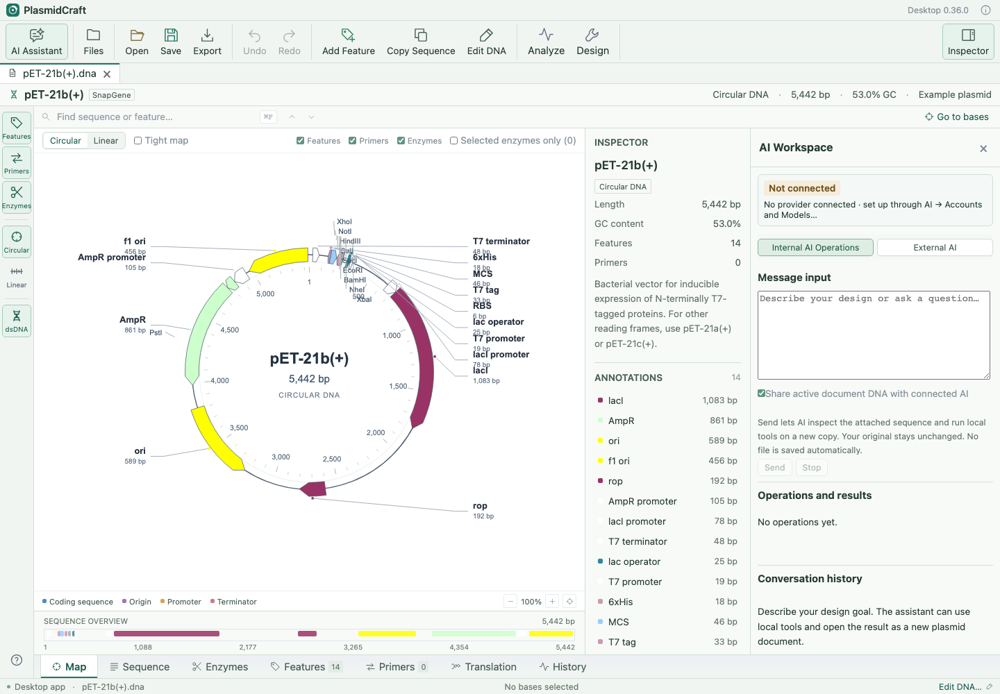

# AI design assistant — desktop 0.36

The **AI Assistant** toolbar button toggles a docked panel beside the sequence inspector. It leaves map/sequence editing available. On narrow windows it tiles below the editor. Close with the panel's × button; response and request text remain in the current session. Opening or closing other tool dialogs does not cancel AI work. Closing the AI panel itself cancels pending sign-in/inference and suppresses late responses.

The current-context box follows active documents and selected DNA/features without sending data. **Send** captures current internal context; **Preview outgoing prompt** is available in External AI. Existing responses/proposals remain tied to their original source; changing source DNA requires preparing a new request before applying a proposal.

Use **AI → Accounts and Models…** for connection setup in a separate dialog. It works with the AI panel closed. Configure a provider and model there, click **Done**, then use **Internal AI Operations…** or the toolbar button. The panel has two options: **Internal AI Operations** and **External AI**. Internal mode has message input at the top, operations and results in the middle, and conversation history at the bottom. Each area can scroll independently. Settings and login controls stay in the menu dialog; closing it preserves the active connection and conversation. Closing settings during sign-in cancels that sign-in, while closing it during an ordinary AI request leaves the request running.

API connections are remembered by default on this computer. Enter the key once, choose a model and click **Save and connect**. The key, provider, endpoint and model are restored automatically at app startup from the app’s local configuration, without Keychain authorization prompts or a request to the AI service. A dismissed, unconnected key draft is cleared. The last-used eligible ChatGPT account and model reconnect automatically at startup; sessions renew during restoration or use when necessary. Browser sign-in is requested again only if the saved session cannot be renewed or the required authorization is missing. The panel shows the provider/model connection status without account controls.

Type a request in the message input at the top; Internal AI does not require a workflow prompt. Connected AI uses validated local tools, shows conversation history and an operations summary, and opens changed designs as new unsaved document tabs. **External AI** retains the manual prompt-copy, paste and review workflow. Opening the panel does not submit a request.

## Connect a provider

1. Open **AI → Accounts and Models…**. Choose OpenAI API, Anthropic/Claude API, Google Gemini API, or an OpenAI-compatible endpoint.
2. Enter the provider’s API key. After you finish typing/pasting it, **Available API models** loads automatically; select a model from the dropdown. For compatible services, enter the base URL (ending in `/v1` where required). HTTPS is required except for HTTP localhost endpoints. The preset localhost URL is suitable for an Ollama OpenAI-compatible server; enter the exact installed model name. LM Studio and other compatible services can use their own base URLs. Compatibility depends on their Chat Completions implementation.
3. Leave **Remember this connection on this computer** checked and click **Save and connect**. The key field clears; the native process saves one connection (key, provider, endpoint and selected model) in `api/connection.json` inside the app configuration folder. This works on all desktop platforms. Saving a different API connection replaces the previous saved connection. The renderer receives only public connection/model status. **Test connection** makes a small, potentially billable request without plasmid data; configuration alone does not prove provider access.
4. **Disconnect for now** clears the active native session and keeps the saved connection for the next app launch. **Forget saved connection** deletes the Keychain item and disconnects. A failed deletion is reported without claiming the key was removed.
5. The connection is restored automatically on later launches, without sending DNA or messages. **Disconnect for now** keeps the saved connection; **Forget saved connection** clears it. To use a session-only connection, uncheck **Remember this connection on this computer** before connecting. API settings are local JSON outside plasmid documents and exports; Unix file/folder permissions restrict access to your user account. Older Mac Keychain entries are imported only when readable without an authentication dialog.

Provider/model/endpoint preferences are nonsecret values stored in the local app profile. URL credentials, queries and fragments are excluded from saved endpoint preferences. Keys, responses and conversation text are excluded from `.pcraft`/library files and source files. External response drafts remain in memory; internal conversation history is saved locally as described below. Changing the active model in settings is remembered locally for the next reconnect.

The transport uses OpenAI Responses, Claude Messages, Gemini GenerateContent, or OpenAI-compatible Chat Completions. Fixed providers use their official hosts. Redirects are refused, request/response sizes are bounded and requests time out after 120 seconds. Errors do not echo raw provider response bodies or credentials. OpenAI requests set `store:false`; this is not a promise of zero retention by every provider. Provider policies, account access and API charges apply. Inference requests run only when you choose Send or Test. Model discovery makes a separate metadata-only GET request after API-key entry, when opening settings for an active API connection with no cached model list, or when choosing **Refresh model list**. No DNA, document names or prompt text are included in discovery.

Official API contracts: [OpenAI authentication](https://developers.openai.com/api/reference/overview), [Claude API](https://platform.claude.com/docs/en/api/overview), [Gemini GenerateContent](https://ai.google.dev/api/generate-content).

Interface illustration uses a synthetic test document and a mocked provider.

## Available model picker

The picker queries the configured provider’s current model list rather than shipping a fixed list. Supported routes are [OpenAI Models](https://developers.openai.com/api/reference/resources/models/methods/list), [Claude Models](https://platform.claude.com/docs/en/api/models/list), [Gemini Models](https://ai.google.dev/api/models), and OpenAI-compatible `/models` endpoints. Gemini results are restricted to models advertising `generateContent`; other provider lists may include models unsuitable for this assistant, so choose a text-generation model. Listing a model does not guarantee inference quota or compatibility with the configured generation endpoint; Send/Test reports access errors.

A selected model is retained when refreshing. For a connected or restored API connection, discovery uses the native credential without returning it to the interface. Local servers without a key can use **Refresh model list**. If listing is denied, unavailable or empty, the interface explains the problem and **Enter a model ID manually** remains available. Pagination is bounded to 1,000 unique models/ten pages, a 1 MB page limit and a 20-second overall timeout. Changing provider/key or closing settings discards stale results. Discovery never saves a newly entered key; **Save and connect** is still the explicit save step.

## Connected conversation and operations

Send a message to the selected API or eligible account connection. Relevant operations run on a private copy of the active DNA document. The original stays unchanged. The assistant can inspect context, annotate from one/all local libraries, edit or extract DNA, design primers, simulate PCR, optimize CDS codons, design mutagenesis with terminal homology, and run Gibson/Golden Gate design using ordered regions of the working copy and explicitly checked additional templates. Select up to two other open DNA templates under Attach another plasmid; unchecked documents are excluded. Missing sequences and design constraints require clarification rather than invented parts.

The application uses a provider-independent JSON tool protocol with existing HTTP transports. In addition to the built-in tools, the assistant can write custom JavaScript calculations in an isolated local interpreter. It receives the active working copy and explicitly attached templates, without host filesystem, shell or network access. Results can include new plasmid documents and text/table reports. Requests are bounded to six rounds and twelve operations, with 40,000-base designs. Tool results are returned to the provider for follow-up when requested. **Share active document DNA with connected AI** is enabled by default; the checkbox can disable it and its state is remembered. DNA/oligo/protein sequences are omitted from context and tool results when disabled. Names, feature locations, operation summaries and selected context are included. Recent conversation is included by default; its checkbox can disable it. Earlier messages can contain DNA.

Each tool result is validated locally. Failed operations or changed source documents discard the uncommitted working copy. **Stop** or closing the panel suppresses late responses and cancels pending inference. The provider may already count usage. A completed run opens new unsaved documents, with **Open document** and **Save .pcraft…** controls. Saving remains a user action. Biological identity and experimental performance require review.

Conversations and operation summaries are saved locally per document content/name using a SHA-256 identifier; they are not synchronized to cloud storage. The store retains up to 20 document conversations with bounded recent messages. Generated document sequences are saved only through ordinary document saving; the history store retains conversational text, which can itself include pasted DNA. **New conversation** clears the current saved thread. Export a conversation for a portable text copy. Credentials are stored separately in the app configuration, outside conversation history and plasmid files.

## External prompt review

**External AI…** retains the manual website workflow. Prepare/copy a prompt, paste its JSON proposal into **Paste external AI JSON proposal**, review the validated actions, then explicitly create the proposed DNA copies. Prompt preparation and JSON proposal pasting are shown together in this mode. External proposals do not automatically execute. Clearing external text preserves internal conversation history. Supported legacy proposals include annotations, primers, guarded DNA replacement, new DNA and links to existing workflow tools.

## Use a website subscription account

The assistant also supports a manual website handoff: **Copy prompt for external AI**, open ChatGPT, Codex, Claude or Gemini, sign in there, paste the prompt, then paste its JSON response back into PlasmidCraft and review it. The static website buttons do not sign the app into your subscription, access account cookies or send the prompt automatically.

### Direct ChatGPT account login

1. Open **AI → Accounts and Models…**, expand **ChatGPT account login**, and click **Continue with ChatGPT**. Complete the official sign-in/consent page in your system browser. The app receives a loopback callback and returns focus to its window.
2. Select an account-provided model. Only models returned for that account are listed; PlasmidCraft does not guess which models a plan includes. **Test connection** makes a small request and consumes plan quota. No plasmid DNA is included in this test.
3. On later launches, PlasmidCraft restores the last-used ChatGPT account and selected model automatically. It renews access when needed without opening browser sign-in. **Use saved session** remains available for manual retry or account switching. A temporary offline error retains the saved session; reconnect is retried when the connection returns. **Sign out selected account** disables automatic restoration for that account and attempts remote revocation.
4. Use the saved-account selector and **Use saved session** to switch accounts or retry a connection manually. **Sign in again / grant plan access** requests fresh authorization for that registration. **Sign out selected account** attempts server revocation and removes local credentials. If revocation cannot be confirmed, the notice says so; review connected apps in your account as needed.

This implements OpenAI's documented eligible open-source [plan sign-in](https://developers.openai.com/siwc/token-sharing-open-source/sign-in), [account/session handling](https://developers.openai.com/siwc/token-sharing-open-source/profiles-and-sessions), and [streamed inference](https://developers.openai.com/siwc/token-sharing-open-source/models-and-inference). Eligibility is controlled by OpenAI and has not been confirmed for this unpublished local app. A ChatGPT subscription alone does not guarantee access through every third-party application. Identity-only login can succeed while plan inference remains disabled; reauthorize if the account is eligible but has not granted the necessary scopes.

Native sign-in uses PKCE, state and nonce, validates signed ID tokens against discovery/JWKS, and binds credentials to the issued application client and verified account subject. Matching email addresses never merge registrations. Refreshes are serialized across app processes and rotating credentials are saved atomically. The renderer receives public status/model information, never access or refresh tokens. Credentials are not borrowed from Codex, copied from browser cookies, included in project files, or written into source files.

ChatGPT sessions are saved locally on every desktop platform, in separate files under the app configuration folder’s `chatgpt/sessions/` directory. Nonsecret registration metadata and the last-used account are in `chatgpt/accounts.json`. Unix files/folders are restricted to the current user; credentials stay in the native process and outside browser storage, plasmid documents and exports. Older Mac Keychain sessions are imported only when readable without an authentication dialog. If no last-used account is recorded, an older profile with exactly one eligible saved session can reconnect automatically; multiple accounts require choosing one once. Signing out prevents restoration or silent switching to another saved account. Live account eligibility has not been verified in development.

ChatGPT plan requests use streamed Responses with `store:false` and require a completed response. Cancel stops waiting for inference, though provider usage may already have occurred. An in-progress token renewal finishes saving rotating credentials before cancellation is applied. Model listing and sign-in contact the provider without sending document DNA. Other providers continue to use their supported API-key routes or manual website handoff.

## Verification

The provider adapters, context whitelist and proposal validation have unit checks. The UI is exercised with a simulated native bridge. Native tests cover loopback callbacks, JWT validation, account isolation, storage failures, token replacement, supported request bodies and streamed response handling; API-key HTTP transport also uses a local mock server. No real key, paid request or private plasmid upload was used during development. Live provider/account acceptance and native-window UI acceptance remain pending.

External AI offers **Design plasmid** for a guided request and **Other tasks** for an open-ended request under **Choose a starting point…**. Edit the message before sending. Selecting a starting point does not send a request.

The External AI workflow list begins with **Review plasmid**, then **Design plasmid**; **Other tasks** is last. The other workflows retain their order. The **Message input** box starts at approximately 128 pixels tall and can be resized vertically.

Conversation history displays newest messages first. Internal tools include CDS inspection and verified amino-acid range replacement with host-preferred codons only for replaced residues. Duplicate identical JSON operation envelopes execute once; malformed envelopes are retried once without being displayed as chat. Operations are checked locally and changed results open as unsaved documents. The Inspector separates readable descriptions from detailed provenance.

## Custom computation and gene replacement

Ask Internal AI to replace an annotated gene with supplied coding-strand DNA, or select an additional open template containing the replacement gene. The gene-replacement tool preserves vector flanks, respects orientation and updates neighboring annotation coordinates. Results open as new unsaved copies. Save the resulting document with **Save .pcraft…** or export GenBank for exchange.

For tasks absent from the menus, AI can write and run local JavaScript algorithms. Reports, tables and expandable calculation code appear in Operations and results; tables can be exported as CSV. Local calculations have bounded memory and execution time. **Stop** cancels a calculation and discards the unfinished working copy.

Local-first computation is the default. When local computation is insufficient, cloud fallback is available for an OpenAI API connection with DNA sharing enabled. These defaults do not require controls in the conversation panel. It uses provider-hosted Python and may incur API/container charges. Results are downloaded and validated before being opened locally; temporary containers are deleted on a best-effort basis. This route has mock transport tests, but live paid-provider execution has not been verified.

Regular ChatGPT website/app users can also run cloud calculations and receive files. The current third-party Sign in with ChatGPT interface [does not expose Code Interpreter](https://developers.openai.com/siwc/token-sharing-open-source/preview-limitations). Login connections therefore use local computation in PlasmidCraft. Under **External AI**, use **Export plasmid for AI…** and **Copy file-editing prompt**, attach the exported GenBank file in your AI chat, then use **Import AI-edited plasmid…** to open its returned file as a new unsaved copy. The existing pasted-JSON workflow remains available.

After tools execute, their actual results are returned to the model before its completion summary. A failed or stopped turn discards uncommitted copies. The conversation panel keeps the message box, operations/results and newest-first history; account configuration remains in AI → Accounts and Models.

The compact **Working on: [plasmid name]** line follows the active document. Expand **Attach another plasmid** to select up to two additional open DNA templates.
