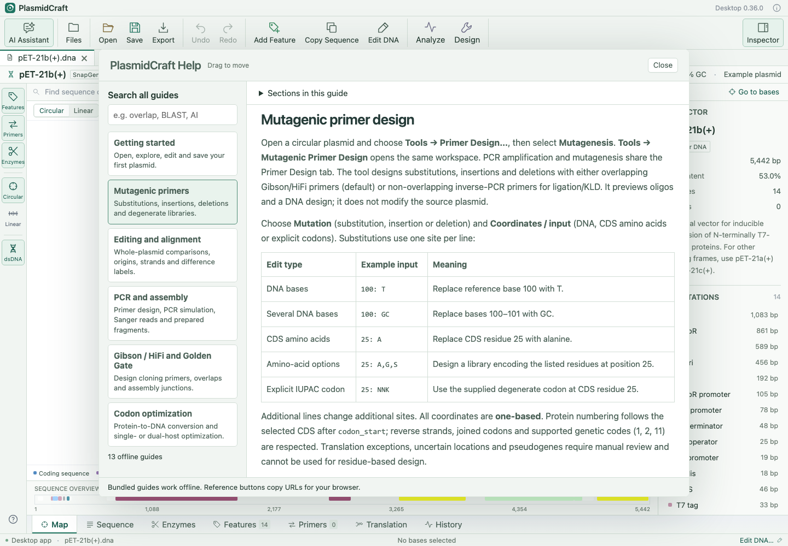

# Getting started with PlasmidCraft

PlasmidCraft is a local desktop workspace for plasmid viewing, editing, protein analysis and cloning design. These guides are included in the app and can be read offline. Internet access is needed only for optional external services such as connected AI and NCBI BLAST.

## Start with a real plasmid

The app opens the supplied **pET-21b(+)** plasmid (5,442 bp) by default. Its original file is `examples/pET-21b(+).dna` in the source distribution. Choose **Help → Open pET-21b(+) Example** to reopen it. This example has annotations but no saved primers.

Choose **File → Open Sequence…**, use the Open toolbar button, or drag a sequence file into the window. Supported inputs include GenBank, DNA FASTA/plain text, SnapGene `.dna`, Sanger `.ab1` and native `.pcraft` documents. Use **File → New from Pasted Protein…** for protein input. Multi-record sequence files can open several documents. After installing the app, you can also set PlasmidCraft as the default application for supported sequence files and open them by double-clicking. In Finder, use Get Info → Open with → PlasmidCraft → Change All for a format; on Windows use Open with → Choose another app → Always. Installed packages include a PlasmidCraft document icon. Linux file managers use MIME icons and the selected icon theme.

## Find your way around

- **Map** shows circular or linear DNA. Circular/Linear changes the current document topology as well as the map. The change takes effect immediately in searches, restriction analysis, primers/PCR, ORFs, alignment, annotation, AI context and exports, even before saving. It is remembered independently for each open document, marks the document unsaved and supports Undo/Redo. Save **.pcraft** to retain it when reopening or restarting the app. Old files with a separate saved map choice apply that choice once as an undoable topology change. The original source file stays untouched until an explicit save or export. Circular DNA has no free-end metadata; Undo restores the previous linear ends. Click a feature to inspect it. Tight map mode places labels along the circle and hides restriction-enzyme markings.
- **Sequence** is a continuous, width-adaptive DNA display. CDS translations appear below DNA, with residue numbering every five amino acids. DNA and protein selections highlight together. Choose one-letter or three-letter protein notation in the sequence controls.
- The **sequence overview** below Map and Sequence lets you select annotated regions and navigate the document.
- **View** controls panels and lists. The Inspector describes the selection; Files shows open documents.
- **Edit** contains annotation and DNA changes, selection copying and undo/redo. Floating tool windows can be moved by their title bars so the map and sequence stay accessible.
- **Tools** contains the analysis and design workflows, including feature-library management. The toolbar provides two focused dropdowns: **Analyze** for auto annotation, restriction/PCR analysis, alignment and protein analysis, and **Design** for primers, mutagenesis, cloning/assembly, codon optimization and protein-to-DNA. **AI** contains account setup and the internal/external AI workspaces.

## Make and save an edit

Select DNA and choose **Edit → Insert, Replace or Delete DNA…**. Preview the result before applying it. Use Undo to return to an earlier state. In Features, check annotations and choose **Remove selected features** to remove them together; one Undo restores them. Full primer oligos are retained. Select a feature to edit its annotation; use Add Feature to annotate selected DNA or start auto annotation.

Use **Save PlasmidCraft Document** to save `.pcraft`, which retains the supported document state, annotations, primers and saved analyses. Export GenBank, FASTA, SVG or **Export SnapGene format** for exchange. Exchange formats retain different subsets of information; keep a `.pcraft` master copy. There is no autosave or crash recovery.

## Choose a workflow

| Task | Where to begin | Guide |
| --- | --- | --- |
| Compare complete plasmids | Open both documents; Tools → Align Whole Plasmids… | [Editing and alignment](SEQUENCE_VERIFICATION.md) |
| Align Sanger or DNA reads | Tools → Align Sanger / DNA Reads… | [PCR and assembly](WORKFLOWS.md) |
| Design ordinary or mutagenic primers | Tools → Primer Design… or Mutagenic Primer Design… | [Mutagenic primers](MUTAGENESIS.md) |
| Design Gibson / HiFi or Golden Gate cloning | Tools → Design Gibson Cloning… or Design Golden Gate Cloning… | [Cloning design](CLONING_DESIGN.md) |
| Optimize an annotated coding sequence | Right-click a CDS → codon optimization | [Codon optimization](CODON_OPTIMIZATION.md) |
| Analyze a protein or submit BLAST | Right-click a CDS → protein analysis or protein BLAST | [Protein analysis and BLAST](PROTEIN_ANALYSIS_AND_BLAST.md) |
| Import features or auto-annotate | Tools → Feature Libraries… or Auto Annotation… | [Feature libraries and exchange](FEATURE_CATALOG_AND_EXCHANGE.md) |
| Ask connected AI to work on a copy | AI → Accounts and Models… once; then Internal AI Operations… | [AI connections and operations](AI_ASSISTANT.md) |

## Try the workflow examples

Choose **Help → Load Workflow Examples** for synthetic tutorial inputs demonstrating PCR, read alignment, Gibson and Golden Gate workflows. They are practice data, not experimentally validated constructs. The supplied pET-21b(+) startup plasmid is separate from these tutorials.

## Use AI deliberately

Configure a connection through **AI → Accounts and Models…**. Internal AI Operations accepts messages and uses supported local tools to create new unsaved documents with operation summaries and conversation history. Review the DNA-sharing control before sending; internal document-DNA sharing defaults on and remembers your choice. Save resulting documents explicitly.

External AI provides prompt preparation and pasted JSON proposal review. It does not require a connected account. See [AI connections and operations](AI_ASSISTANT.md) and [Privacy and local data](../PRIVACY.md).

## Get more help

Choose **Help → User Guide and Search…** to search all bundled guides, browse topics and jump to sections. The guide window is movable and stays separate from editing dialogs. Links between bundled guides work offline. External reference URLs can be copied for use in a browser.

Review designed sequences, annotations, primer conditions and biological assumptions before laboratory use. See [Verification and limitations](VALIDATION.md).
