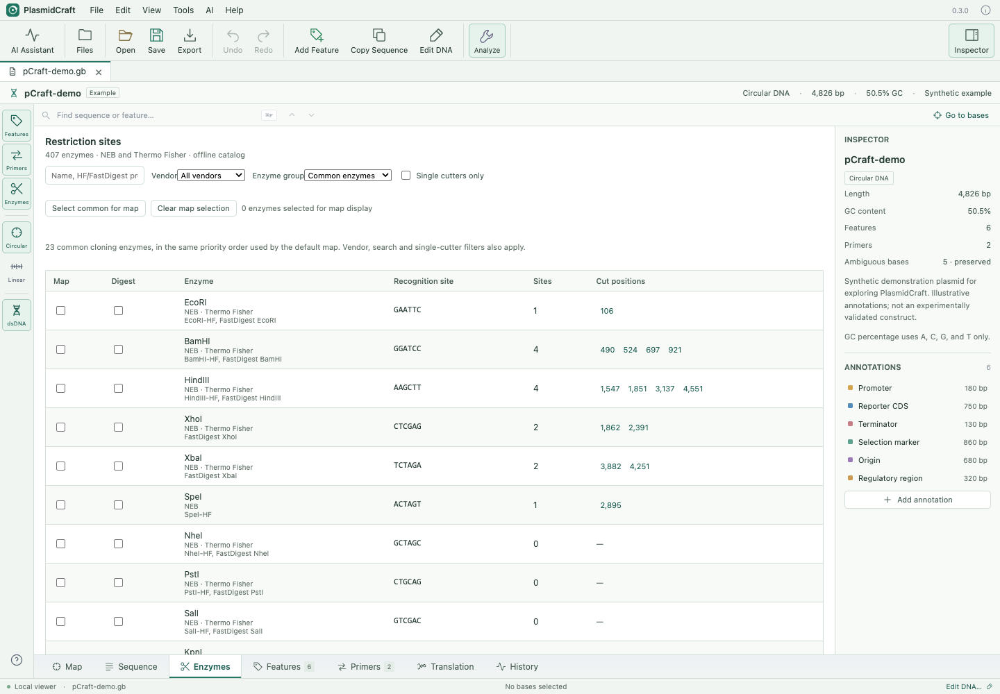

# Sequence verification and editing

[Organism-based CDS recoding and protein-to-DNA conversion](CODON_OPTIMIZATION.md) include dual-host optimization.

## Tight circular maps

In Map view select **Circular**, then enable **Tight map**. Full mapped feature names follow the circle; overlapping features use concentric tracks and small features get nearby curved labels. Coordinates and strand arrows remain unchanged. Labels are not truncated. Activating Tight map automatically hides restriction-enzyme labels and ticks. You can explicitly turn Enzymes back on for compact ticks with names on hover. Primers retain their directional tracks. Feature, primer and enzyme visibility controls still apply.

The **Common enzymes** group contains **23 common cloning enzymes**, matching the map priority preset. It is not selected automatically. Custom Map checkboxes start empty; the default map shows up to 10 single cutters automatically. In the **Enzymes** tab, choose **Enzyme group → Common enzymes** to see that set in priority order. Use the **Map** checkboxes to add or remove individual enzymes; these choices immediately control cut sites when you return to Map. **Selected enzymes only** is initially off and is enabled when you edit the map selection. **Select common for map** explicitly selects the preset, and **Clear map selection** empties the custom selection and removes its marks. Selections apply across open documents during the session. **Digest** checkboxes independently choose a combined-digest prediction and start empty.

The group is a convenient routine-cloning preset; supplier prices, pack sizes and local availability vary. Group/vendor/search/**Single cutters only** filters affect table rows without changing map or digest selections. The preset also includes enzymes with multiple sites; a zero-cutter adds no mark. The same map selection applies to circular, linear, tight and exported maps. Up to 40 sites are displayed, with a notice when more are selected. Tight mode still hides enzyme markings when activated; explicitly turn **Enzymes** on to show the selected set. Clearing **Selected enzymes only** uses an automatic display of up to 10 single cutters.

**Export → SVG** preserves the tight, square vector layout with embedded text paths and full labels, at the full map extent regardless of screen zoom. For dense maps, hide unwanted annotation classes or export at a larger physical size to retain readable text. The standard callout layout remains available by turning Tight map off.

## Continuous Sequence view

The Sequence tab displays DNA as one scrolling document, with a single vertical scrollbar and no Previous/Next pages. CDS protein translations appear on the corresponding side of their DNA strand by default. **CDS proteins** toggles them, and **Protein notation** selects **1-letter** or **3-letter** amino acid labels. Hover a residue for its identity, residue number and codon coordinates. Reverse-strand CDSs follow their annotated direction. Translation uses each CDS’s codon start and supported genetic code; unsupported annotations show a warning. **Reading frames** shows a selected frame, all three on either strand, or all six; the frame genetic code is chosen separately from each CDS’s own annotation. Reverse frames are anchored to the complete reverse complement, and frames do not reset at row boundaries. **Group bases** selects groups of 10 or 3. Primer letters align to template columns, forward above the reference and reverse below its complement. Arrows point to oligo 3′ ends, mismatches are red and mixed bases amber; 5′ tails appear separately from bound DNA. Controls also toggle the complement and direct editing. Search, selected features and Go to Bases scroll to the requested position. Large documents render nearby rows on demand while retaining one continuous coordinate space. Direct editing and selection cross row boundaries; save documents as `.pcraft` to keep annotations and history.

## Whole-plasmid comparison

Open both DNA documents. Activate the fixed reference, then choose **Tools → Align Whole Plasmids** and select the query. **Auto align: shift + strand** considers circular-origin shifts and both orientations. Every base appears in the global alignment; terminal differences are not clipped. The result shows identity, substitutions, insertion/deletion counts, original-query coordinates, and grouped differences with navigation.

Manual orientation is forward or reverse complement. The origin offset is zero-based in the sequence **after orientation**. Shift/flip buttons change the controls; click **Align with manual settings** to recalculate. Turning circular mode off prohibits rotation. The query's circular checkbox is an explicit interpretation override. **Create oriented query copy** makes separate DNA with supported annotation remapping; the sources stay intact.

Up to ten reports, including both DNA snapshots, are stored in the reference .pcraft. JSON reports can also be exported/imported. Changed reference DNA is labeled stale. Reports record sequence evidence; imported reports cannot recover query annotations unless a matching query document is open.

The engine first detects exact circular equivalence. Otherwise, exact seeds propose origins on both strands and banded affine-gap global alignment scores them (+2 match, −3 mismatch, −5 gap opening, −1 gap extension; uncertain columns score zero). This is a heuristic origin search, not exhaustive rearrangement mapping or multiple-sequence alignment. Limits are 200 kb per molecule, 32 million cells per candidate and 64 million per automatic run. Repeats can produce equivalent placements. Large indels may require a wider band and manual origin; a path touching the band or incomplete candidate search is flagged. Independent global-score checks do not establish exhaustive origin optimality.

## Sanger consensus and read assembly

First save a read alignment using the existing **Align Sanger Reads** tool. On its unchanged reference choose **Tools → Read Assembly & Consensus**. Select the saved report, quality threshold, minimum independent depth and weighted-support threshold. Preview before creating a separate consensus document or exporting evidence JSON.

Quality weights are 1−10^(−Q/10), after minimum-Phred filtering. Unresolved and uncovered positions become N. Supported substitutions and indels are applied; indels need appropriate flanking quality evidence. Failed, ambiguous and search-limited placements and identical name/DNA/quality duplicate evidence are excluded. Unscored DNA is excluded unless explicitly treated as Q20. This is a thresholded evidence summary, not calibrated variant probabilities. The original .pcraft read report retains full chromatograms; evidence JSON includes read calls, qualities, CIGARs, pileup and variants. Consensus DNA carries provenance but is not a synthetic chromatogram.

The **De novo exact-overlap read assembly** mode accepts 2–24 selected reads, each at most 5,000 bases, optionally quality-trimmed. It considers both strands and unique contained reads, joining uniquely preferred exact suffix/prefix overlaps. Competing joins remain separate contigs. Mismatched/gapped overlaps use the reference-guided workflow. Output is linear and does not establish plasmid closure. Contig evidence records placements and orientation.

## Editing and annotation tools

In Sequence view, enable **Edit bases**. Click an insertion point and type/paste IUPAC DNA. Arrow/Home/End/Page keys move the cursor; Shift selects a region. Backspace/Delete remove bases, and the existing Undo/Redo works. These edits use the annotation-remapping engine and invalidate physical end metadata. Extract DNA first to edit a trace-derived template.

**Inline CDS proteins** aligns translated residues to codon centers, respecting supported genetic code, strand, phase and joined locations. Unsupported coding annotations produce notices. At most 30 overlapping CDS tracks, each up to 200 kb, are rendered on a page.

In Features view, select annotation checkboxes or **Select listed annotations**, then **Bulk edit selected**. Preview type, color or qualifier changes and apply as one undo step. Coding-semantic changes invalidate cached protein text. Coordinate edits remain in the individual annotation editor.

The **History** tab displays a branching graph. Restore a retained state and edit to create a new branch. Format 3 .pcraft files retain up to 100 DNA/annotation/primer states within 20 MB; older states can be trimmed and a single oversized state cannot be retained. Trace channels and saved alignment reports remain outside graph snapshots. History requires saving the document; it does not provide autosave or crash recovery. Format 3 readers accept older format 1/2 documents; older application versions cannot read format 3.

## Primers from selected DNA

Select 2–200 bases in Sequence view, then right-click and choose **Create primer from selection**, or use the button above the sequence / in the selection inspector. **Tools → Primer from Selected DNA** opens the same editor. All oligos are shown 5′→3′. Choose forward/reverse orientation, hand-edit the annealing sequence, and optionally add a separate 5′ tail. Changing orientation reverse-complements the edited annealing sequence while retaining the 5′ tail.

The live global alignment highlights substitutions, insertions, deletions and uncertain template bases. Add/remove letters directly in the primer region: its length can differ from the selected template span. Template/oligo gaps, difference counts, exact terminal 3′ match and its Tm are shown. Gaps in repeats can have alternative equally plausible positions; review the inferred placement. The full edited oligo and user-assigned placement persist in `.pcraft`. The source DNA stays unchanged. Use **Edit primer** in the primer inspector, or Edit in the primer library for mapped A/C/G/T primers, to revise the oligo later. Changes support Undo/Redo.

A mapped placement containing mismatches is a reviewed design, not proof of annealing. Tm describes an ideal complementary duplex of the edited oligo, without mismatch correction. Other binding sites are not searched in this editor. PCR simulation independently recomputes binding. Its default **3′-anchored extension** mode supports upstream changes when the required terminal stretch remains exactly complementary; the optional full-region mode permits up to three substitutions with an exact 3′ clamp. Neither mode accepts gaps inside the required terminal match. Candidate sites may differ from the manually assigned placement. Mixed/degenerate codon libraries use **Primers → Primer Design → Mutagenesis**, documented in the [mutagenic primer guide](MUTAGENESIS.md).

## Linked DNA and protein selection

Sequence view packs CDS translations on a shared line when their positions do not overlap. Overlapping CDS use additional lanes on their respective strands. Click a residue, drag across residues, or Shift-click to extend; Enter/Space also selects a focused residue. The corresponding codon bases on both DNA strands highlight together. Selecting DNA highlights overlapping residues; protein copying includes only completely selected codons. One-letter and three-letter display use the same selections.

Use **Edit → Copy Selected Sequence…** (or Copy Sequence) to choose reference/top DNA, reverse-complement/bottom DNA, or a selected CDS protein. Both DNA options are exported 5′→3′. **Export FASTA…** saves the chosen sequence. Joined CDS protein selections retain exact codon segments and omit intervening introns. The status bar shows selected amino acid and base counts for a protein selection.

## Sequence overview and annotation navigation

The shared **Sequence overview** stays at the bottom of Map and Sequence views. Click an annotation bar to select its full annotated region and inspect it; overlapping annotations occupy separate lanes, and joined/circular-origin features retain their separate pieces. Buttons include names and coordinates in tooltips and support keyboard selection. Dense lane stacks scroll within the compact overview.

In Sequence view, selecting an annotation from the overview, sequence tracks or inspector brings its start near the vertical center of the sequence viewport. The same behavior applies when switching from a selected map feature into Sequence, including long sequences using windowed rendering. Starts near the document ends are limited by available scroll space. Base editing and ordinary caret navigation retain their existing behavior.
